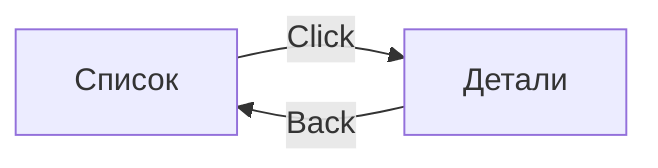

# RFC-[НОМЕР]: [Название фичи / предложения]

* **Статус:** [Draft | In Review | Accepted | Rejected | Implemented]
* **Дата:** [ГГГГ-ММ-ДД]
* **Автор(ы):** [Имя / GitHub username]
* **Задача в трекере (Epic):** [TP-XXX]
* **Связанный ADR:** [docs/adr/XXXX.md или N/A]

---

## 1. Краткое резюме (Summary)

В 2–3 предложениях опишите суть фичи, цель её внедрения и ожидаемую ценность для пользователя или кодовой базы.

---

## 2. Мотивация и User Story (Motivation)

* Какую проблему решает фича?
* **User Story:** *Как [роль пользователя], я хочу [действие], чтобы [получить результат].*
* Текущее поведение vs Предлагаемое поведение.

---

## 3. Архитектурное проектирование (Detailed Design)

### А. Модель данных и состояние (State & Models)
```kotlin
data class FeatureState(...)

sealed interface FeatureIntent {
    ...
}
```

### Б. Интерфейс компонента и навигация
```kotlin
interface FeatureComponent {
    val state: Value<FeatureState>
    fun onIntent(intent: FeatureIntent)

    fun interface Factory {
        operator fun invoke(
            componentContext: ComponentContext,
            onSuccess: () -> Unit,
            onBack: () -> Unit,
        ): FeatureComponent
    }
}
```

### В. Потоки данных и интеграция (Data Flow & Services)
* Какие репозитории или UseCase'ы задействованы?
* Требуются ли новые таблицы БД или сетевые эндпоинты Ktor?

---

## 4. UI и экраны (UI Flow)

* Какие экраны и состояния (Loading, Empty, Error, Content) будут разработаны?
* Текстовая схема переходов или Mermaid-диаграмма:


---

## 5. Риски, ограничения и открытые вопросы (Risks & Open Questions)

* Какие краевые случаи (edge cases) могут возникнуть (оффлайн, отсутствие сети, ошибки прав)?
* На какие компромиссы мы идем?
* **Открытые вопросы:**
  1. [Вопрос 1]
  2. [Вопрос 2]

---

## 6. План декомпозиции на задачи (Implementation Tasks)

Список атомарных задач для создания подзадач в таск-трекере (Jira / Linear / Plane):
- [ ] `TP-X1`: Создать контракт фичи в `:features:xxx:api`
- [ ] `TP-X2`: Реализовать бизнес-логику и репозиторий в `:features:xxx:impl`
- [ ] `TP-X3`: Сверстать Stateless UI и Stateful Screen
- [ ] `TP-X4`: Интегрировать в навигационный граф `RootComponent`
- [ ] `TP-X5`: Покрыть Unit-тестами логику компонента
